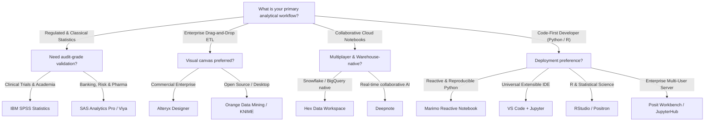

# 🌟 Awesome Data Science IDEs & Notebook Platforms

**A curated index of top-tier SaaS platforms, interactive notebooks, and open-source integrated development environments (IDEs) engineered for modern Data Science, Machine Learning, and Analytical Engineering workflows.**

*Focusing on collaborative cloud notebooks, enterprise MLOps runtimes, reactive data development, and reproducible analytical pipelines.*

📅 **Last Updated:** October 2026

---

[📊 Sector Overview](#-sector-overview--market-dynamics) • [🏢 SaaS Platforms](#-saas--hosted-platforms) • [💻 Open-Source IDEs](#-open-source-github-projects) • [⚖️ Feature Matrix](#-comparative-feature-matrix) • [🧭 Decision Guide](#-ide-selection-guide) • [❓ FAQs](#-frequently-asked-questions) • [🤝 Contributing](#-how-to-contribute)

---

## 📖 Introduction & Ecosystem Scope

Modern data science demands far more than basic text editing. Data professionals need interactive runtime environments where exploratory code execution, rich visualizations, package management, distributed computing, and reproducible pipelines converge seamlessly.

This repository tracks two complementary pillars of the modern analytical toolchain:
1. **🏢 Enterprise & Cloud SaaS Platforms:** Governed, multi-tenant workbenches offering zero-setup browser computing, SSO, centralized package control, automated load balancing, and enterprise AI orchestration.
2. **💻 Open-Source Projects & Notebooks:** Community-driven, self-hostable runtimes, reactive computational notebooks, and IDEs providing total developer sovereignty, transparency, and vendor independence.

---

## 📊 Sector Overview & Market Dynamics

The global **Data Science & Machine Learning Platform market** is estimated at **$140B–$220B in 2025–2026**, expanding at a rapid **CAGR of ~17%–20%** toward an estimated $750B+ by 2035 driven by generative AI adoption, data democratization, and enterprise compliance mandates. 

The sector is **moderately fragmented**: legacy enterprise stalwarts (IBM, SAS) and cloud hyperscalers anchor regulated industries and large corporations, while specialized collaborative notebook startups (Hex, Deepnote, Dataiku) and innovative open-source architectures (JupyterLab, Marimo, Positron, VS Code) maintain high differentiation across code-first, visual workflow, and warehouse-native niches—preventing a single "winner-take-all" outcome.

---

## 🏢 SaaS & Hosted Platforms

Below is the comprehensive comparison of leading SaaS data science workbenches and hosted analytics platforms, **sorted in descending order by company size** (market capitalization or private valuation).

| 🏢 Product & Provider | 📈 Company Size (Revenue / Valuation) | 💰 Pricing (Starting Tier) | 🎁 Free Tier / Free Trial Limits | 🎯 Core Capabilities & Best For |
| :--- | :--- | :--- | :--- | :--- |
| **[IBM SPSS Statistics](https://www.ibm.com/products/spss-statistics)** | **$215 Billion** Market Cap *(~$62.5B Annual Revenue)* | **$109 / user / month** *(Base Subscription auto-renewing digital license)* | **14-day free trial** *(Full desktop access to SPSS Base + advanced statistical modules, no credit card required)* | 🏛️ **Regulated Research & Academia:** The gold standard for social sciences, psychology, clinical trials, and government research requiring menu-driven, audit-grade statistical rigor, ANOVA, and custom tables. |
| **[SAS Analytics Pro & Viya](https://www.sas.com/)** | **~$14.0 Billion** Valuation *(~$3.2B Annual Revenue)* | **~$8,700 / year** *(Standard commercial base license; or SAS Viya pay-as-you-go from ~$0.55/core-hour)* | **Free forever via SAS OnDemand for Academics** *(5GB cloud storage, 2 vCPUs, SAS Studio interface for non-commercial study)* / **14-day SAS Viya free trial** *(Cloud analytics, visual ML & pipelines)* | 🏦 **Enterprise Compliance & Banking:** Audit-grade statistical procedures for regulated banking, risk modeling, and FDA clinical submission pipelines where decades of methodological stability are mandatory. |
| **[Alteryx One / Designer](https://www.alteryx.com/)** | **$4.4 Billion** Valuation *(Acquired by Clearlake/Insight; ~$900M Annual Revenue)* | **$250 / user / month** *($3,000 / user / year billed annually for Starter Edition)* | **30-day free trial** *(Full Alteryx Designer desktop & cloud experience, 1 named user, unlimited workflow executions)* | 🔄 **Visual Self-Service ETL:** 300+ drag-and-drop workflow tools for data preparation, geospatial analytics, and predictive modeling with Alteryx Copilot GenAI integration for enterprise business analysts. |
| **[Dataiku](https://www.dataiku.com/)** | **$3.7 Billion** Valuation *(Series F; ~$250M+ ARR)* | **$499 / month** *(Dataiku Cloud Launch tier)* | **Free forever edition (Self-Hosted)** *(Up to 3 users, local compute, visual ML & data prep)* / **14-day Cloud Trial** *(4 vCPUs, 32 GB RAM, 1 API service, up to 5 collaborators)* | 🤖 **Universal Governed AI:** Named a Leader in the 2025 Gartner Magic Quadrant for DS/ML; features unified LLM Mesh, Agent Management, Cobuild natural language pipelines, and no-code/code-first hybrid tooling. |
| **[Anaconda Cloud & Enterprise](https://www.anaconda.com/)** | **$1.5 Billion** Valuation *(Series E; ~$100M+ ARR)* | **$15 / user / month** *(Starter Plan with 10GB cloud storage & AI Assistant)* | **Free forever plan** *(For individuals, students, non-profits, and businesses with ≤200 employees; includes 5GB cloud storage, standard conda repositories, and 5 compute hours/month)* | 📦 **Governed Package Ecosystem:** Centralized Python/R package management, private package repositories for secure open-source supply chains, air-gapped enterprise deployments, and one-click model APIs. |
| **[Posit Workbench](https://posit.co/products/enterprise/workbench/)** | **~$1.0 Billion** Valuation *(Posit PBC; ~$100M+ Annual Revenue)* | **$4,995 / year** *(Standard base tier for 5 named users)* | **45-day free evaluation trial** *(Full enterprise server license for up to 5 concurrent sessions across RStudio Pro, Positron, VS Code, and JupyterLab with load balancing)* | 🖥️ **Enterprise Multi-IDE Platform:** Reference standard for centralized R & Python data science teams; provides multiple concurrent sessions, PAM/SSO authentication, session impersonation, and load balancing. |
| **[Posit Cloud](https://posit.cloud/)** | **~$1.0 Billion** Valuation *(Posit PBC; ~$100M+ Annual Revenue)* | **$25 / month** *(Cloud Basic: 150 compute hours/mo, 8GB RAM, 2 CPUs, unlimited projects)* | **Free forever plan** *(25 compute hours/month, 1GB RAM, 1 CPU, 1 hr max session execution, up to 25 projects, 3 concurrent projects)* | ☁️ **Instant Zero-Setup R/Python:** Browser-based data science platform featuring preview access to Positron with built-in Posit Assistant AI, Shiny/Flask app publishing, and zero local configuration. |
| **[Hex](https://hex.tech/)** | **~$1.0 Billion** Valuation *(Series C; $140M+ total funding; ~$30M+ ARR)* | **$36 / editor / month** *(billed annually at $432/yr or $45/mo monthly for Professional tier)* | **Free forever plan (Community)** *(Up to 5 projects, 1 author seat, unlimited read-only viewers, 4GB RAM / 0.5 CPU compute profile, 100 AI actions/month)* | 📊 **Warehouse-Native Collaborative Workspace:** Connects directly to Snowflake, BigQuery, and Databricks; blends SQL and Python in reactive notebooks to build interactive data apps without moving data. |
| **[Deepnote](https://deepnote.com/)** | **~$250 Million** Valuation *(Series A; $24M+ funding; ~$10M+ ARR)* | **$9 / editor / month** *(billed annually or $12/month monthly for Team plan)* | **Free forever plan** *(Unlimited personal projects, 1 editor, 3 active projects, unlimited compute hours on Basic machines: 2 vCPU, 5GB RAM)* | ⚡ **Multiplayer Real-Time Notebooks:** AI-native collaborative data science workspace featuring Google Docs-style multiplayer editing, Deepnote AI assistance, scheduling, and on-demand GPU instances (T4, L4, A100). |
| **[KNIME Community & Business Hub](https://www.knime.com/)** | **~$100 Million** Valuation *(~$30M+ funding; ~$30M+ ARR)* | **$19 / month** *(Community Hub Pro: 120 workflow credits/mo) or $99/mo for Team (3 members)* | **Free forever plan** *(KNIME Analytics Platform: 100% free unlimited desktop execution, 300+ data connectors) + Community Hub Free (20 K-AI interactions/month, public workflow repository)* | 🧩 **Open-Core Visual Workflow Automation:** Free desktop graphical canvas for ETL, machine learning, and reporting; commercial hub enables cloud execution, scheduled pipelines, and team collaboration spaces. |

---

## 💻 Open-Source GitHub Projects

Explore the premier open-source data science IDEs, interactive notebook frameworks, and analytics workbenches. **Sorted in descending order by GitHub stargazers count.**

### 1. [Visual Studio Code](https://github.com/microsoft/vscode) 
- **License:** MIT License  
- **Primary Languages:** TypeScript, JavaScript, Python, R, Julia, C++  
- **Overview:** The world's most widely adopted code editor, transformed into a powerhouse Data Science IDE through official Microsoft extensions for Python, Jupyter Notebooks, R, Julia, and Docker. Combines native interactive notebook cell execution, variable inspectors, remote SSH/container development, and debugging in a single interface.
- **Key Features:** Native `.ipynb` support, interactive variable dataframe viewer, GitHub Copilot integration, remote development containers (Dev Containers).

### 2. [DBeaver](https://github.com/dbeaver/dbeaver) 
- **License:** Apache-2.0  
- **Primary Languages:** Java, SQL  
- **Overview:** Free universal database tool and SQL IDE supporting any database with a JDBC driver (PostgreSQL, MySQL, ClickHouse, Snowflake, DuckDB, SQLite, BigQuery). Essential for analytical engineers and data scientists inspecting tables, writing complex analytical SQL, and visualizing schema relationships.
- **Key Features:** ER diagram generation, spatial data viewer (GIS), data export to CSV/JSON/Markdown, visual query builder, and mock data generation.

### 3. [Marimo](https://github.com/marimo-team/marimo) 
- **License:** Apache-2.0  
- **Primary Languages:** Python, TypeScript  
- **Overview:** A next-generation reactive Python notebook that solves the hidden-state reproducibility problems plaguing legacy notebooks. Running a cell automatically triggers all downstream dependent cells (like a spreadsheet DAG). Can be executed as standard pure Python scripts, deployed as interactive web apps, or compiled to WASM.
- **Key Features:** Reactive execution graph, pure Python `.py` file format, built-in interactive UI elements (sliders, dropdowns, tables), package sandboxing, and zero hidden out-of-order state.

### 4. [JupyterLab](https://github.com/jupyterlab/jupyterlab) 
- **License:** BSD-3-Clause  
- **Primary Languages:** TypeScript, Python  
- **Overview:** The modular and extensible next-generation web interface for Project Jupyter. Supports 40+ programming languages through pluggable kernels (IPython, IRkernel, IJulia). Offers tabbed dock panels, integrated terminals, markdown renderers, and a massive ecosystem of third-party extensions.
- **Key Features:** Flexible multi-panel layout, interactive debugger, real-time collaboration (RTC) extension, Git integration, and language-agnostic kernel execution.

### 5. [Jupyter Notebook](https://github.com/jupyter/notebook) 
- **License:** BSD-3-Clause  
- **Primary Languages:** Python, JavaScript  
- **Overview:** The foundational document-centric interactive computing standard. Combines live code execution, equations, narrative prose, and rich visual output into a shareable `.ipynb` file format that underpins the entire modern data science industry.
- **Key Features:** Document-oriented interface, lightweight setup, broad educational adoption, and seamless export to HTML, PDF, and LaTeX via nbconvert.

### 6. [Spyder IDE](https://github.com/spyder-ide/spyder) 
- **License:** MIT License  
- **Primary Languages:** Python  
- **Overview:** The Scientific Python Development Environment—designed specifically for scientists, researchers, and quantitative analysts. Provides a familiar MATLAB-style experience with an interactive IPython console, deep multi-dimensional variable inspector, and Matplotlib integration.
- **Key Features:** Interactive Variable Explorer for NumPy arrays and Pandas DataFrames, real-time code analysis, integrated documentation viewer, and advanced interactive debugging.

### 7. [JupyterHub](https://github.com/jupyterhub/jupyterhub) 
- **License:** BSD-3-Clause  
- **Primary Languages:** Python  
- **Overview:** The multi-user orchestrator for Jupyter Notebooks and JupyterLab. Enables universities, research laboratories, and corporate data teams to serve scalable, containerized computing environments to thousands of simultaneous users on Kubernetes (Zero to JupyterHub) or Docker.
- **Key Features:** Pluggable authentication (OAuth, GitHub, LDAP, PAM), containerized user pod spawning, dynamic resource quotas, and centralized administration.

### 8. [Apache Zeppelin](https://github.com/apache/zeppelin) 
- **License:** Apache-2.0  
- **Primary Languages:** Java, Scala, Python  
- **Overview:** Web-based polyglot notebook designed for distributed Big Data analytics. Features pluggable backend interpreters that enable seamless mixing of Apache Spark (Scala), PySpark, SQL, Python, R, and Shell within the same computational notebook session.
- **Key Features:** Native Apache Spark cluster integration, dynamic forms and widgets, multi-interpreter architecture, and built-in interactive pivot tables and charts.

### 9. [Quarto CLI](https://github.com/quarto-dev/quarto-cli) 
- **License:** GPL-2.0  
- **Primary Languages:** TypeScript, Pandoc  
- **Overview:** An open-source scientific and technical publishing system from Posit. Compiles plain markdown text, Jupyter Notebooks, or Knitr documents into high-quality publications, books, interactive dashboards, presentations, and websites across Python, R, Julia, and Observable.
- **Key Features:** Multi-language execution, publication-quality typography, automated citation formatting, interactive HTML widgets, and static site generator capabilities.

### 10. [Orange Data Mining](https://github.com/biolab/orange3) 
- **License:** GPL-3.0  
- **Primary Languages:** Python  
- **Overview:** Open-source visual programming environment for exploratory data analysis, data mining, and machine learning. Users drag and drop prebuilt analytical widgets to build interactive workflows with zero code required.
- **Key Features:** Rich interactive visual widgets (scatter plots, dendrograms, tree viewers), visual model training (Random Forest, SVM, Naive Bayes), and add-on extensions for bioinformatics and text mining.

### 11. [Pluto.jl](https://github.com/fonsp/Pluto.jl) 
- **License:** MIT License  
- **Primary Languages:** Julia, JavaScript  
- **Overview:** Lightweight, reactive notebook environment built specifically for the Julia scientific language. Every cell behaves like a reactive cell in a computational graph—changing a variable in one cell immediately and automatically recalculates all affected cells without manual execution.
- **Key Features:** 100% reactive execution, pure Julia script persistence (`.jl`), built-in package environment management, interactive UI slider bindings, and zero hidden global mutable state.

### 12. [RStudio Desktop & Server](https://github.com/rstudio/rstudio) 
- **License:** AGPL-3.0 (Open-Source Edition)  
- **Primary Languages:** C++, Java, TypeScript, R  
- **Overview:** The quintessential integrated development environment for the R language. Combines a console, syntax-highlighting editor with smart completion, workspace environment inspector, integrated documentation, graphics plotting pane, and comprehensive package building tools.
- **Key Features:** Native package management, Shiny application preview and debugging, Git/SVN version control pane, Knitr report authoring, and workspace history persistence.

### 13. [Polynote](https://github.com/polynote/polynote) 
- **License:** Apache-2.0  
- **Primary Languages:** Scala, TypeScript, Python  
- **Overview:** Created by Netflix, Polynote is a polyglot interactive notebook with first-class Apache Spark and Scala support. Enforces deterministic top-to-bottom cell execution to eliminate reproducibility hazards and allows transparent data sharing across Scala, Python, and SQL cells.
- **Key Features:** Top-to-bottom execution flow, interactive Scala auto-completion via metals, seamless Spark cluster monitoring, and cross-language variable sharing.

### 14. [Positron](https://github.com/posit-dev/positron) 
- **License:** Elastic License 2.0 / Open-Source Core  
- **Primary Languages:** TypeScript, Python, R  
- **Overview:** Posit's next-generation data science IDE built on the modern VS Code Code-OSS foundation. Engineered specifically for exploratory data science in Python and R, offering a persistent console, active data explorer, dedicated variables pane, and native AI pair programming.
- **Key Features:** Native DataFrame Inspector with sorting and filtering, dedicated Variables pane, persistent execution console, and deep language runtime awareness for Python and R.

---

## ⚖️ Comparative Feature Matrix

| Tool / Platform | Deployment Mode | Supported Languages | Core Strength | AI Assistance | Enterprise Governance |
| :--- | :--- | :--- | :--- | :--- | :--- |
| **IBM SPSS Statistics** | Desktop / Cloud SaaS | SPSS Syntax, Python, R | Survey & Classical Statistics | 🟡 Basic | 🟢 High (Audit-grade) |
| **SAS Viya / Pro** | On-Prem / SaaS Cloud | SAS, Python, R | Regulated Risk & FDA Clinical | 🟢 SAS Viya Copilot | 🟢 Maximum |
| **Alteryx Designer** | Desktop / Cloud SaaS | Visual Canvas, Python, R | Drag-and-Drop ETL / Pipelines | 🟢 Alteryx Copilot | 🟢 High |
| **Dataiku** | Self-Hosted / SaaS Cloud | Python, R, SQL, Visual | Unified Enterprise AI & ML | 🟢 Cobuild & LLM Mesh | 🟢 Maximum |
| **Anaconda Enterprise**| Self-Hosted / Cloud SaaS | Python, R | Governed Package Repository | 🟢 Anaconda Assistant | 🟢 High |
| **Posit Workbench** | On-Prem / VPC / Cloud | R, Python, SQL | Multi-IDE Enterprise Server | 🟢 Posit Assistant | 🟢 High |
| **Hex** | Cloud SaaS / VPC | SQL, Python, R | Warehouse-Native Interactive Apps | 🟢 Hex Magic AI | 🟢 High |
| **Deepnote** | Cloud SaaS | Python, SQL, R | Real-Time Multiplayer Notebooks | 🟢 Deepnote AI | 🟡 Medium |
| **VS Code + Jupyter** | Desktop / Web / Containers| Language Agnostic (100+) | Extensibility & Universal Code | 🟢 GitHub Copilot | 🟡 User Managed |
| **Marimo** | Self-Hosted Local / Web | Python | Reactive Reproducible Notebooks | 🟡 Extensible | 🟡 User Managed |
| **JupyterLab** | Self-Hosted / JupyterHub | 40+ Languages | Flexible Docked Notebook Layout | 🟡 Extension-based | 🟢 via JupyterHub |
| **RStudio** | Desktop / Server | R, Python, SQL | Statistical Computing & Shiny | 🟡 Copilot Plugin | 🟢 via Workbench |
| **Positron** | Desktop / Cloud Preview | R, Python | Data Inspection & Clean State | 🟢 Posit Assistant | 🟡 Emerging |

---

## 🧭 IDE Selection Guide: Which Tool Should You Choose?

- **For Enterprise Teams & Regulated Industries:** Choose **Dataiku** or **SAS/SPSS** when strict model governance, FDA/Basel compliance, and enterprise LLM gateways are required.
- **For Warehouse-Native Analytics (Modern Data Stack):** Choose **Hex** to execute SQL and Python directly inside Snowflake, BigQuery, or Databricks without data egress.
- **For Collaborative Fast-Moving Data Teams:** Choose **Deepnote** for instant real-time multiplayer editing and built-in GPU acceleration.
- **For Modern Python Data Scientists:** Choose **Marimo** for reactive, non-linear reproducibility or **VS Code + Jupyter** for end-to-end software engineering workflows.
- **For Statistical Computing & R Specialists:** Choose **RStudio** (or the modern **Positron**) backed by **Posit Workbench** for enterprise team deployment.

---

## ❓ Frequently Asked Questions (FAQs)

<b>1. What is the key difference between a computational notebook and a traditional IDE?</b>

Traditional IDEs (like PyCharm or standard VS Code) execute code in monolithic script runs from top to bottom, making them ideal for software engineering and application development. Computational notebooks (Jupyter, Marimo, Hex) allow iterative, cell-by-cell execution, preserving intermediate memory states and rendering graphs, dataframes, and markdown inline—optimizing for exploratory data analysis (EDA) and narrative storytelling.

<b>2. Why is hidden state a problem in Jupyter notebooks, and how do modern tools fix it?</b>

In classic Jupyter notebooks, cells can be executed out of order, leading to "hidden state" where variable states do not reflect the visual sequence of the notebook. Modern reactive alternatives like <b>Marimo</b> and <b>Pluto.jl</b> model execution as a Directed Acyclic Graph (DAG): modifying or running an upstream cell automatically invalidates and recomputes all downstream dependents, guaranteeing strict reproducibility.

<b>3. When should an organization choose Posit Workbench over free open-source RStudio/JupyterLab?</b>

While open-source RStudio Server and JupyterLab provide individual developer functionality, <b>Posit Workbench</b> provides enterprise capabilities: simultaneous hosting of multiple session types (VS Code, JupyterLab, RStudio, Positron), centralized PAM/LDAP/SAML single sign-on, server-side load balancing, per-user CPU and memory quotas, and session impersonation for administrative debugging.

<b>4. Are free tiers sufficient for learning and personal data science projects?</b>

Yes! Platforms like <b>Posit Cloud</b> (25 free hours/mo), <b>Hex Community</b> (5 free projects with full warehouse connectors), and <b>Deepnote</b> (unlimited hours on basic machines) offer generous free tiers. Furthermore, open-source options like <b>Marimo</b>, <b>VS Code</b>, and <b>JupyterLab</b> are 100% free with no compute restrictions other than your local machine hardware.

---

## 🤝 How to Contribute

We welcome community contributions! To add a new platform or update existing information:

1. 🍴 **Fork** this repository.
2. 🌿 **Create a branch** for your feature or update: `git checkout -b feature/add-new-ide`.
3. ✏️ **Edit `README.md`**: Follow the established formatting conventions (include name, URL, specific pricing, exact free tier limits, badges, and factual summaries).
4. 🔍 **Verify details**: Ensure links resolve to official vendor or GitHub project repositories.
5. 🚀 **Submit a Pull Request (PR)** with a concise summary of your addition.

⭐ **Star this repository** if you find it helpful for your data science and analytics engineering journey!

---

## 📜 Disclaimer

- *This repository is community-curated for informational and comparative purposes only. Trademarks and product names belong to their respective copyright holders.*
- *Data compliance and governance: Data science IDEs processing sensitive customer data must adhere to relevant compliance frameworks (SOC2, HIPAA, GDPR, CCPA).*

---

**Built with ❤️ for Data Scientists, Machine Learning Engineers, and Analytics Developers worldwide.**

*Let's make Data Science IDEs more transparent, reproducible, and accessible.*

